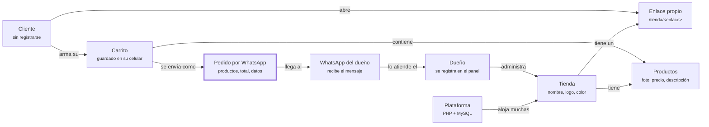
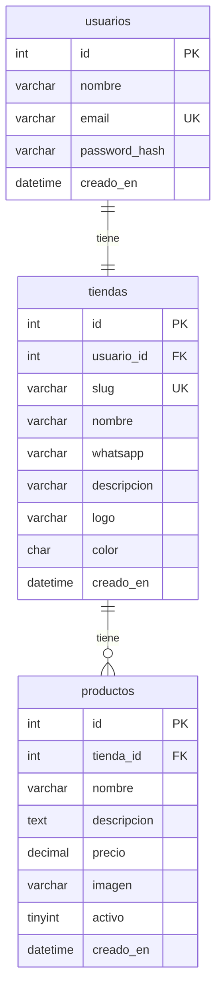

# Tienda WhatsApp: documentación y mapa conceptual

Tienda WhatsApp es una plataforma donde cualquier negocio crea su catálogo en línea en minutos y recibe los pedidos directo en su WhatsApp. Varias tiendas viven en la misma instalación, cada una con su propio enlace (`/tienda/<enlace>`).

- **Para el dueño:** crea su cuenta y su tienda, sube productos con foto, precio y descripción, y comparte su enlace.
- **Para el cliente:** abre el enlace, arma su pedido y lo envía por WhatsApp con un toque. No necesita registrarse.
- **Tecnología:** PHP 8 + MySQL sin frameworks, para correr en XAMPP y en Hostinger tal cual.

## Mapa conceptual

El pedido del cliente llega armado al WhatsApp del dueño. Se lee siguiendo las flechas.



## Flujos

**Dueño de la tienda**

1. Entra a `registro.php` y escribe su nombre, correo, contraseña, nombre de la tienda, enlace y WhatsApp. El enlace se sugiere solo a partir del nombre.
2. Queda dentro del panel. Ahí ve el enlace de su tienda con botones para copiarlo y compartirlo por WhatsApp.
3. En **Mi tienda** sube su logo, escribe una descripción corta y elige el color.
4. En **+ Agregar** crea cada producto: foto, nombre, precio y descripción. Puede ocultarlo sin borrarlo.
5. Comparte el enlace con sus clientes (estados, redes, grupos).

**Cliente**

1. Abre el enlace `/tienda/<enlace>` desde el celular.
2. Toca **Agregar** en cada producto y ajusta cantidades con + y −. El pedido se guarda en su celular aunque cierre la página.
3. Toca la barra **Ver pedido**, escribe su nombre y, si quiere, la dirección o notas.
4. Toca **Enviar pedido por WhatsApp**. Se abre WhatsApp con el mensaje listo hacia el número del dueño, y el cliente lo envía.

Ejemplo del mensaje que le llega al dueño:

```
*Nuevo pedido - Panadería Don Pancho*

2 x Pan francés = $5.000
1 x Torta de chocolate = $45.000

*Total: $50.000*

Cliente: Ana
Notas: Calle 10 #5-20
```

## Modelo de datos

Tres tablas en MySQL (`sql/schema.sql`). Un usuario tiene exactamente una tienda, y una tienda tiene muchos productos. Si se borra un usuario, se borran su tienda y sus productos.



Los pedidos no se guardan en la base de datos: viajan completos en el mensaje de WhatsApp. Las fotos se guardan en la carpeta `uploads/` y la base solo guarda el nombre del archivo.

## Estructura de archivos y rutas

| Ruta en el navegador | Archivo | Qué hace |
| --- | --- | --- |
| `/` | `index.php` | Página de inicio de la plataforma |
| `/registro.php` | `registro.php` | Crear cuenta y tienda |
| `/login.php`, `/logout.php` | `login.php`, `logout.php` | Entrar y salir |
| `/panel/` | `panel/index.php` | Lista de productos y enlace para compartir |
| `/panel/producto.php` | `panel/producto.php` | Crear, editar, ocultar y eliminar un producto |
| `/panel/tienda.php` | `panel/tienda.php` | Nombre, enlace, WhatsApp, descripción, logo y color |
| `/tienda/<enlace>` | `tienda.php` | Tienda pública con carrito |
| `/tienda/<enlace>/manifest.json` | `manifest.php` | Datos para instalar la tienda como app |
| `/icono.php` | `icono.php` | Ícono de la app (logo o inicial con el color) |

Archivos de apoyo:

- `inc/app.php`: configuración, conexión a la base, sesión, CSRF y utilidades.
- `inc/imagenes.php`: subida y reducción de fotos.
- `inc/layout.php`: cabecera y pie del sitio y del panel.
- `assets/estilos.css` y `assets/tienda.js`: diseño y carrito.
- `sw.js`: permite instalar la tienda en el celular.
- `.htaccess`: convierte `/tienda/<enlace>` en `tienda.php` y bloquea archivos internos. `router.php` hace lo mismo con `php -S`.

## Instalación

Los pasos para XAMPP y Hostinger están en el [README](../README.md).

**Configuración (`config.php`)**

| Clave | Para qué sirve | Valor por defecto |
| --- | --- | --- |
| `db` | Servidor, puerto, base, usuario y clave de MySQL | `127.0.0.1`, `catalogo`, `root` sin clave |
| `app_name` | Nombre que aparece en el sitio y el panel | `MiCatálogo` |
| `moneda` | Símbolo junto a los precios | `$` |
| `indicativo_por_defecto` | Se agrega si el dueño escribe el WhatsApp de 10 dígitos | `57` (Colombia) |

## Seguridad y límites del MVP

**Seguridad incluida**

- Contraseñas con `password_hash`, sesión renovada al entrar y espera de 1 minuto tras 5 intentos fallidos.
- Todas las consultas usan sentencias preparadas (PDO) y todos los formularios llevan token CSRF.
- Cada consulta del panel filtra por la tienda del dueño, así nadie edita productos ajenos cambiando el número en la dirección.
- Las fotos se revisan y se vuelven a guardar como JPG de máximo 1000 px y 5 MB. La carpeta `uploads/` no ejecuta PHP.
- `config.php`, `inc/` y `sql/` están bloqueados desde el navegador.

**Lo que este MVP todavía no hace**

- No guarda un historial de pedidos: el dueño los ve solo en WhatsApp.
- No tiene recuperación de contraseña por correo.
- No tiene categorías, inventario ni variantes (tallas, sabores).
- Una cuenta maneja una sola tienda.
- El precio del mensaje lo calcula el celular del cliente, así que el dueño confirma el total en el chat.
